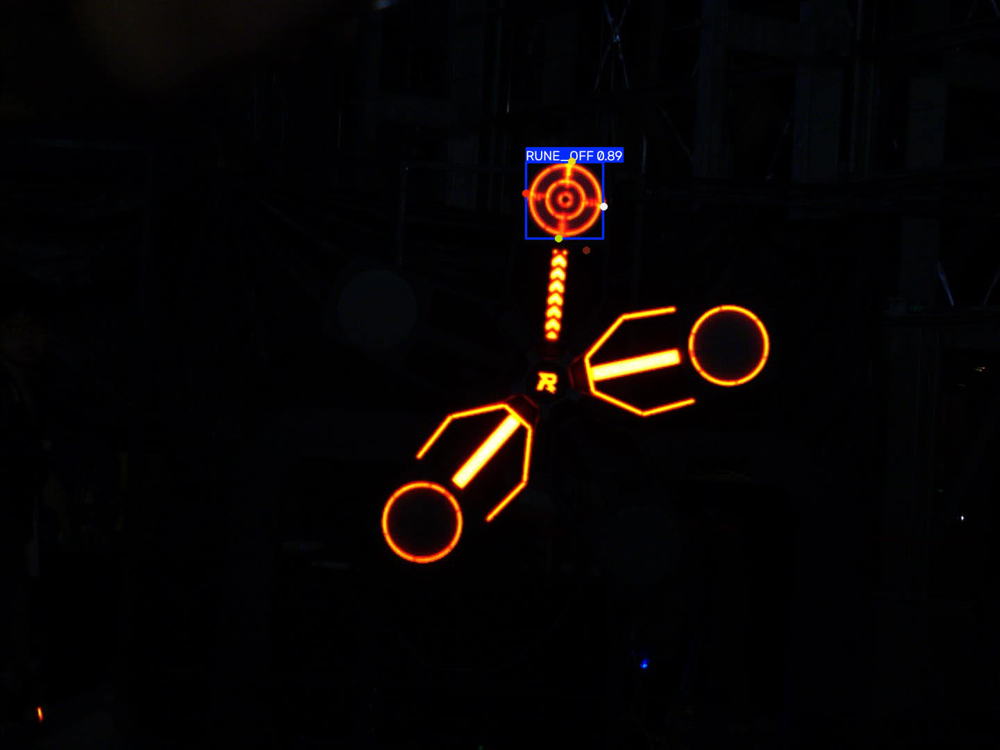
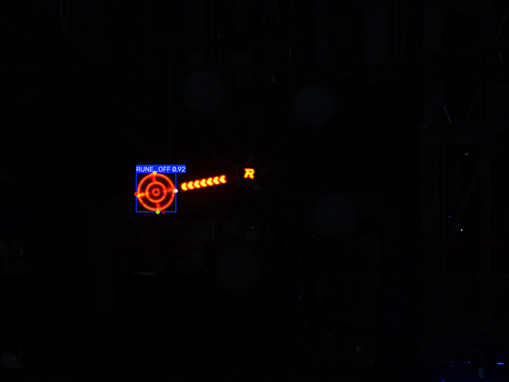
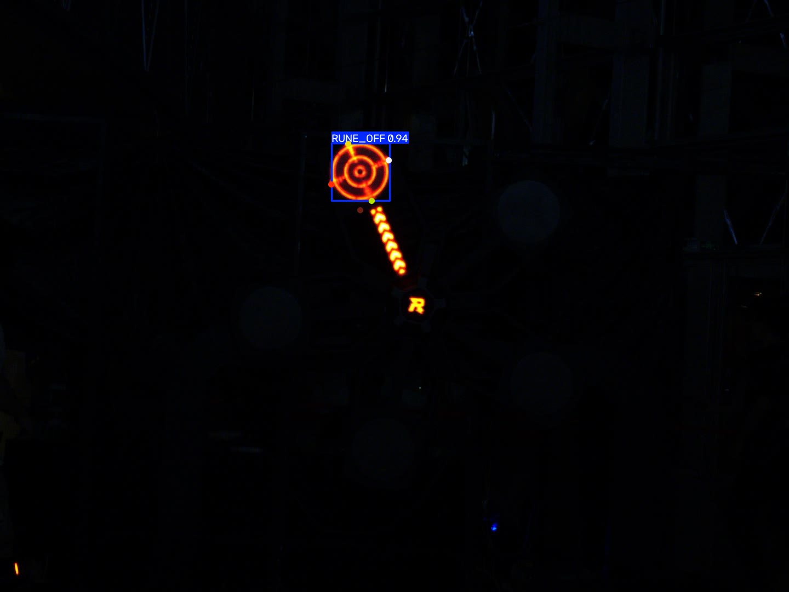
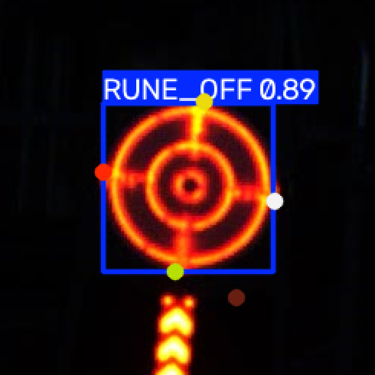

# RMStage2-1-rune_v1 · 能量机关（5 关键点，失败版本）

> 结论先说：**这个模型不要用。** Pose mAP50-95 = 0.597，比 4 关键点版本低 0.398。

---

## 一、训练信息

| 项 | 值 |
|---|---|
| 权重 | `weights/best.pt`（第 39 轮） |
| 数据 | `~/RMStage2/rune_dataset`（train 620 / val 10） |
| 标签 | **15 列**：类别 + 框 + 叶片 4 角 + **R 标圆心** |
| `kpt_shape` | `[5, 2]` |
| 类别 | `0: RUNE_OFF`、`1: RUNE_ON`（实际只用到 0） |
| 模型 | YOLO26n-pose，从 `yolo26n-pose.pt` 微调 |
| 轮数 / 耗时 | 100（patience 30，**第 69 轮早停**）/ 3.7 min |
| 增强 | `hsv_s 0.5`、`hsv_v 0.25`、`mosaic 1.0`、`fliplr 0.5` |
| 输出 | `[1, 16, 8400]`（4 框 + 2 类 + 5×2 关键点） |

---

## 二、指标

| 指标 | 值 |
|---|---:|
| Box P / R | 0.994 / 1.000 |
| Box mAP50 / mAP50-95 | 0.995 / 0.972 |
| Pose P / R | 0.994 / 1.000 |
| Pose mAP50 | 0.995 |
| **Pose mAP50-95** | **0.597** ⚠️ |

**关键现象**：Pose mAP50-95 从第 10 轮开始**一位小数都没变过**（ep10~ep69 全是 0.597），
同期 Box mAP50-95 还在从 0.871 涨到 0.972。

---

## 三、推理可视化

由 `weights/best.pt` 在验证集推理，框上标注类别与置信度，圆点为关键点。

### 141.png（RUNE_OFF 0.89）



### 14.png



### 78.png



### 141.png 局部放大



## 四、为什么失败

### 逐点误差实测（val 8 个正样本）

| 关键点 | 误差中位 | 90 分位 |
|---|---:|---:|
| 左上 / 左下 / 右下 / 右上 | **1.8 – 3.3 px** | ≤ 4.4 px |
| **R 标圆心（第 5 点）** | **197.6 px** | 275.8 px |

### 模型把圆心"塌"到了叶片附近

| 距离 | 中位 |
|---|---:|
| 预测中心 → 真中心 | 194.5 px |
| **预测中心 → 叶片框中心** | **51.4 px** |
| 真中心 → 叶片框中心 | 183.6 px |

叶片框只有 87 px，圆心距它 **260 px（3 倍框宽）**。
模型从"一个叶片的局部特征"推不出"整幅图的全局坐标"——**学不动，不是架构不可能**。

### 一个点毁掉整个指标

OKS 对 5 个点等权：
四个角点 `d≈2 px` → 贡献 ≈ 0.99；圆心 `d≈198 px` → 贡献 ≈ 0。
`OKS ≈ (0.99×4 + 0)/5 ≈ 0.79`，mAP50-95 在 0.5~0.95 十档取平均 → **0.597**。

---

## 五、结论

| 项 | 结论 |
|---|---|
| Box 分支 | ✅ 可用（0.995 / 0.972） |
| 四个角点 | ✅ 2–3 px，足够 PnP |
| **第 5 点（圆心）** | ❌ **不可用** |
| 整体 | ❌ **被 `RMStage2-1-rune_v2` 取代** |

**替代方案**：见 `../RMStage2-1-rune_v2/`（4 关键点 + 模板匹配求圆心）。

---

## 六、复现

```bash
# 数据（保留 15 列，不删圆心）
ls ~/RMStage2/rune_dataset/train/labels | wc -l     # 620

# 训练
cd ~/RMStage2/yolo26_pose_rmvision
python -u train.py --config rune_train_config_v2.yaml
```

> 注意：这份数据的 yaml 需要 `kpt_shape: [5, 2]`。若误写成 `[4,2]`，
> 654 个标签会被**静默丢弃**，训练在纯背景上空转（本仓库踩过这个坑）。

---

## 七、产物

| 文件 | 说明 |
|---|---|
| `weights/best.pt` | 第 39 轮 |
| `results.csv` | 100 轮曲线（pose95 从 ep10 起恒定） |
| `PosePR_curve.png` / `PoseF1_curve.png` | 曲线（看不出问题） |
| `confusion_matrix.png` | 只有 RUNE_OFF 有实例 |
| `viz/*.png` | 本页的推理可视化 |
| `RM-训练记录rune-v1-README.md` | 完整复盘（仓库根目录） |
