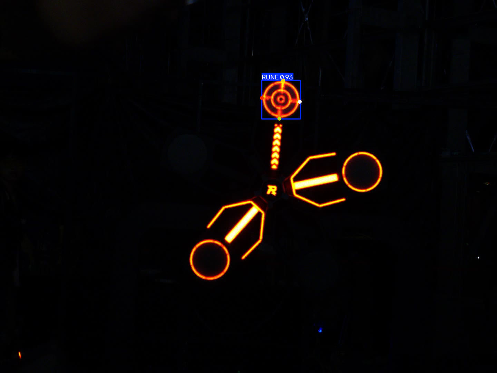
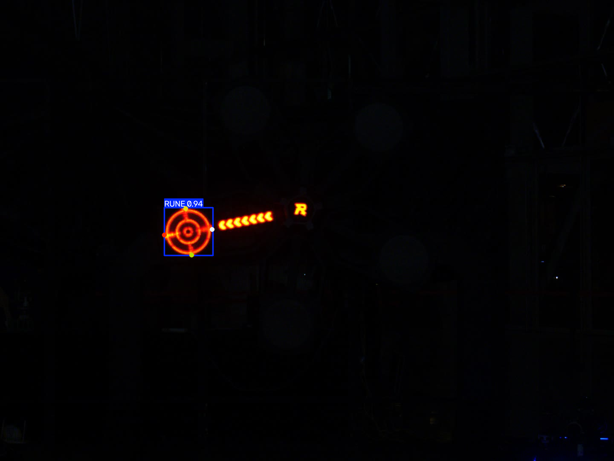
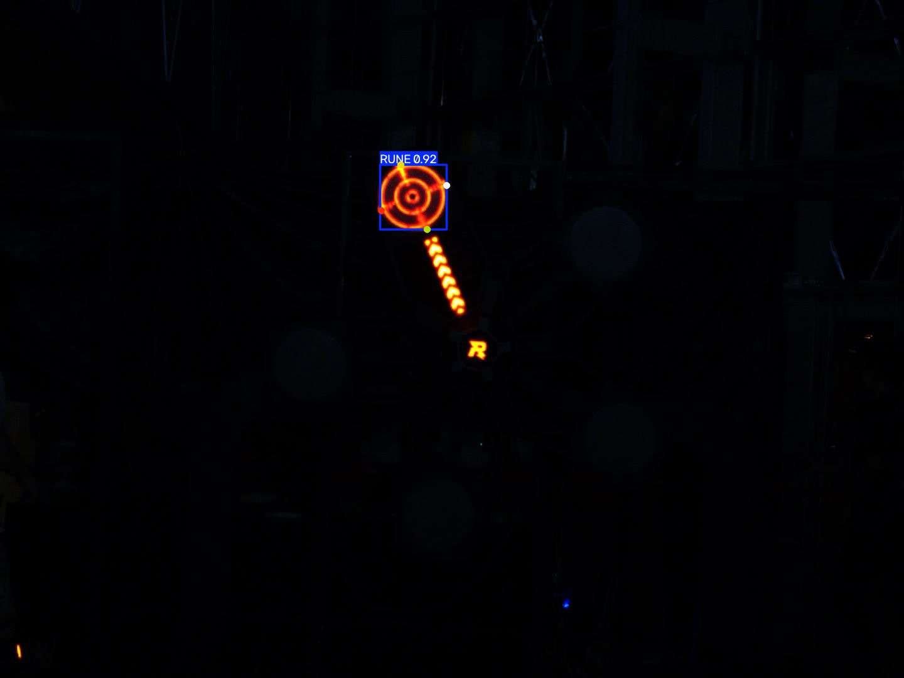
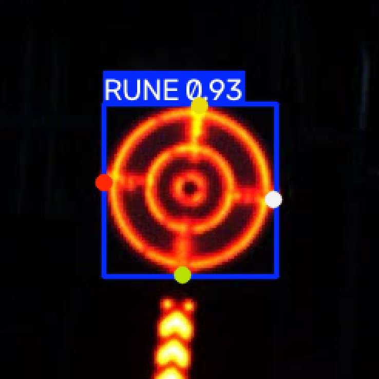

# RMStage2-1-rune_v2 · 能量机关（4 关键点，推荐版本）

> **当前可用版本。** Pose mAP50-95 = **0.995**（比 5 关键点版高 0.398）。
> 圆心不再由网络回归，改由 **R 标模板匹配**（误差 1.5 px）提供。

---

## 一、训练信息

| 项 | 值 |
|---|---|
| 权重 | `weights/best.pt`（第 100 轮，跑满） |
| 数据 | `~/RMStage2/rune_dataset_v2`（train 620 / val 10） |
| 标签 | **13 列**：类别 + 框 + 叶片 4 角（**无圆心**） |
| `kpt_shape` | `[4, 2]`，`flip_idx: [2, 1, 0, 3]` |
| 类别 | `0: RUNE`（单类） |
| 模型 | YOLO26n-pose，从 `yolo26n-pose.pt` 微调 |
| 轮数 / 耗时 | 100 / **5.1 min** |
| 增强 | `hsv_s 0.5`、`hsv_v 0.25`、`mosaic 1.0`、`close_mosaic 10` |
| **导出输出** | **`[1, 13, 8400]`**（4 框 + 1 类 + 4×2 关键点） |

---

## 二、指标

| 指标 | v1（5 点） | **v2（4 点）** |
|---|---:|---:|
| Box mAP50 | 0.995 | 0.995 |
| Box mAP50-95 | 0.972 | 0.949 |
| Pose mAP50 | 0.995 | 0.995 |
| **Pose mAP50-95** | **0.597** | **0.995** |
| 最佳 pose95 出现 | ep10 后冻结 59 轮 | **ep8 达到并保持到 ep100** |

**代价**：Box mAP50-95 降 2 个点；**收益**：Pose 涨 40 个点。框本来就够用。

---

## 三、推理可视化

由 `weights/best.pt` 在验证集推理，框上标注类别与置信度，圆点为关键点。

### 141.png（RUNE 0.93）



### 14.png



### 78.png



### 141.png 局部放大



## 四、圆心怎么来（不在网络里）

### 模板匹配（主）

```cpp
// assets/rune_logo*.png 全部加载，取最高分
// 缩放按几何推导：模板缩放 = k × 叶片框宽 / 模板原生边长
//   k ∈ {0.30 … 0.50}，实测真实数据 0.41、仿真 0.35
// 环形门限：圆心只接受距叶片中心 [2.0w, 3.4w]
```

| 指标 | 值 |
|---|---|
| 命中率（score≥0.55 且过半径门限） | **146/149 = 98%** |
| 圆心误差中位 | **1.47 px**（95% 3.27 px） |
| 模板响应中位 | 0.988（最低 0.961） |

**用 V = max(R,G,B) 而非灰度**：红/蓝 logo 灰度差 2.6 倍，V 通道红蓝通吃
（实测灰度蓝方命中 7/60，V 通道红蓝各 60/60）。

### 几何兜底（可选）

叶片 ≥2 时，可用 `r ≈ 2.54 × 叶片框宽` 做多帧三角测量；精度 10–50 px，只作兜底。

### 为什么网络不行

圆心距叶片 **260 px（3 倍框宽）**，网络预测会塌到离叶片 51 px 处（真值在 184 px 外），
把 Pose mAP50-95 从 0.995 压到 0.597。详见 `../RMStage2-1-rune_v1/README.md`。

---

## 五、导出与集成

```bash
yolo export model=weights/best.pt format=onnx imgsz=640 opset=12 simplify=True
```

**必须得到 `[1, 13, 8400]`**（`nc = 13 - 4 - 8 = 1`）。

C++ 侧（`lessons/lesson03_detection.cpp`）：

| 项 | 值 |
|---|---|
| 模型路径 | `models/rune.onnx` |
| 类别数 | **1** |
| 解码 | `nc = C - 4 - 8`（与装甲板同一行代码） |
| 角点顺序 | 左上、左下、右下、右上（**原序，不用重排**） |
| 额外 | 模板匹配求 `Detection::center` |

---

## 六、已知局限

| # | 局限 | 影响 |
|---|---|---|
| 1 | val 只有 **10 张 / 9 个实例** | 0.995 的置信区间很宽（但 0.597→0.995 远超噪声） |
| 2 | 单类，不分激活/未激活 | 亮不亮需后处理用框内亮度判断 |
| 3 | 模板跨域敏感 | 仿真里用真实模板只有 0.763，建议加一张 `rune_logo_sim.png`（→0.976） |
| 4 | 蓝方严重过曝 | 颜色门不可行（H/S 失效），只能靠 V 通道 + 多模板 |
| 5 | 圆心依赖模板 | 暗态/遮挡时需几何兜底或外推 |

---

## 七、复现

```bash
# ① 生成 13 列数据（主数据不动）
python /home/mm/dsh/rune_setup/drop_center_kpt.py \
       --src ~/RMStage2/rune_dataset \
       --out ~/RMStage2/rune_dataset_v2 --apply

# ② 自检（必须 ✅）
python /home/mm/dsh/rune_setup/check_rune_yaml.py rune_pose_v2.yaml

# ③ 训练
cd ~/RMStage2/yolo26_pose_rmvision
python -u train.py --config rune_train_config_v2.yaml

# ④ 导出
yolo export model=runs/pose/RMStage2-1-rune_v2/weights/best.pt \
    format=onnx imgsz=640 opset=12 simplify=True
```

---

## 八、产物

| 文件 | 说明 |
|---|---|
| `weights/best.pt` | 第 100 轮 |
| `results.csv` | 100 轮曲线 |
| `training_summary.json` | 指标汇总（耗时 5.1 min） |
| `viz/*.png` | 本页的推理可视化 |
| `RM-训练记录rune-v2-README.md` | 完整记录（仓库根目录） |
