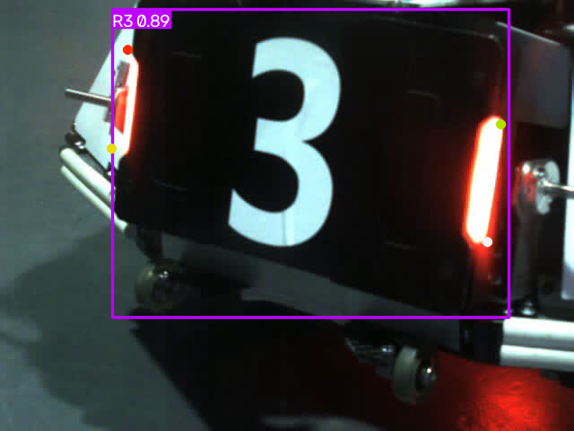
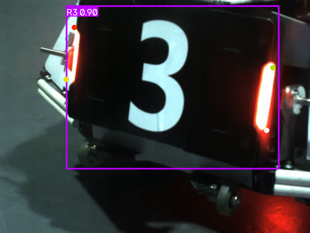
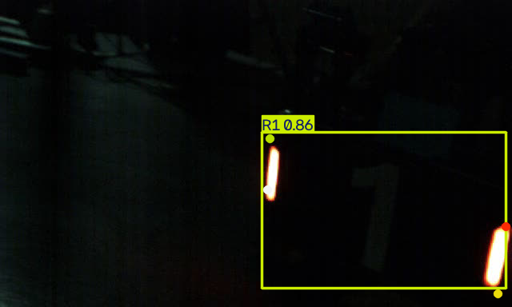

# YOLO26-Pose 初次训练记录

> 第三讲任务 2 的提交材料：模型权重、训练曲线、推理可视化、指标报告。
> 训练框架来自参考项目 [yolo26_pose_rmvision](https://github.com/alectimison-maker/yolo26_pose_rmvision)，
> 数据集来自讲义附件 `dataset.zip`。

---

## 1. 概览

| 项 | 值 |
|---|---|
| 任务 | 单阶段目标检测 + 四角点关键点（YOLO Pose） |
| 模型 | `yolo26n-pose.pt` 微调，2.71 M 参数，6.4 GFLOPs |
| 类别数 | 14（B1–B5、BO、BS、R1–R5、RO、RS） |
| 关键点 | 4 个（每点 x, y），`kpt_shape = [4, 2]` |
| 训练轮数 | 100（best epoch = **97**） |
| 输入尺寸 | 640 × 640 |
| 训练耗时 | **47.4 分钟**（28.4 s/轮） |
| 硬件 | NVIDIA GeForce RTX 5070 Ti Laptop GPU（11.7 GB） |

**核心指标（验证集，第100轮）**

| 指标 | Precision | Recall | mAP50 | mAP50-95 |
|---|---:|---:|---:|---:|
| 装甲板框（Box） | 93.66% | 90.64% | **94.99%** | 67.48% |
| 四角点（Pose） | 86.59% | 83.87% | **84.06%** | 76.59% |

> `Pose mAP50-95`（76.6）高于 `Box mAP50-95`（67.5）是**正常现象**：前者用 OKS 评估，后者用 IoU，两者尺度不同，不可直接比较。

---

## 2. 环境

| 项 | 版本 |
|---|---|
|
| Python | 3.12.16（venv：`/home/mm/RMStage2/.venv`） |
| PyTorch | 2.15.0+cu132 |
| Ultralytics | 8.4.172 |
| CUDA | 13.2（驱动 580.178.04） |
| GPU | RTX 5070 Ti Laptop，11747 MiB |

自检命令：

```bash
python -c "import torch, ultralytics; print(torch.__version__, torch.cuda.is_available(), ultralytics.__version__)"
# 2.15.0+cu132 True 8.4.172
```

---

## 3. 数据

### 3.1 来源与规模

| 项 | 训练集 | 验证集 |
|---|---:|---:|
| 图片 | 5637 | 1409 |
| 标签文件 | 5637 | 1409 |
| 目标实例 | 9202 | 2362 |

> 每张图一个同名 `.txt`，无目标时为空白文件。

### 3.2 类别分布

| 类别 | 训练 | 验证 | 类别 | 训练 | 验证 |
|---|---:|---:|---|---:|---:|
| B1 | 707 | 186 | R1 | 461 | 146 |
| B2 | 788 | 218 | R2 | 904 | 193 |
| B3 | 594 | 131 | R3 | 457 | 120 |
| B4 | **2057** | 532 | R4 | 943 | 270 |
| B5 | 551 | 145 | R5 | 718 | 170 |
| BO | 155 | 36 | RO | 316 | 72 |
| BS | 289 | 74 | RS | 262 | 69 |

分布**明显不均衡**（B4 是 BO 的 13 倍），这直接影响了个别类别的关键点精度（见 5.4）。

### 3.3 数据配置文件

`armor_pose.yaml`：

```yaml
path: "/home/mm/RMStage2/dataset"
train: train/images
val: val/images

kpt_shape: [4, 2]
flip_idx: [3, 2, 1, 0]

names:
  0: B1
  1: B2
  2: B3
  3: B4
  4: B5
  5: BO
  6: BS
  7: R1
  8: R2
  9: R3
  10: R4
  11: R5
  12: RO
  13: RS
```

---

## 4. 训练

### 4.1 关键超参数

| 参数 | 值 | 说明 |
|---|---|---|
| `epochs` | 100 | 实际跑到 100，未触发早停 |
| `patience` | 30 | 早停阈值 |
| `imgsz` | 640 | 输入边长 |
| `batch` | 16 | 显存峰值约 3.3 GB |
| `workers` | 4 | 数据加载进程 |
| `optimizer` | auto | Ultralytics 自动选择 |
| `mosaic` | 1.0 | 4 图拼接增强 |
| `close_mosaic` | 10 | 最后 10 轮关闭 mosaic |
| `fliplr` | 0.5 | 水平翻转（配合 `flip_idx`） |
| `degrees` | 0.0 | 不做随机旋转 |
| `seed` | 42 | 固定随机种子 |

### 4.2 启动命令

```bash
cd ~/RMStage2/yolo26_pose_rmvision
source ~/RMStage2/.venv/bin/activate

python -u train.py --config train_config.yaml 2>&1 | tee train.log
```

> 训练前需保证 `yolo26n-pose.pt`（预训练权重）与 `weights/yolo26n.pt`（AMP 自检用）已就位，
> 否则会卡在 GitHub 下载权重和AMP等依赖上。

### 4.3 每轮耗时

| 阶段 | 耗时 |
|---|---|
| 训练（353 个 batch） | ≈ 25.8 s |
| 验证（45 个 batch） | ≈ 2.5 s |
| 合计 / 轮 | **28.4 s** |

100 轮总耗时 **47.4 分钟**，显存峰值 3.33 GB（卡上还有大量余量）。

---

## 5. 结果

### 5.1 与参考项目对比

| 指标 | 本次 | 参考项目（100 轮全量） | 差值 |
|---|---:|---:|---:|
| Box mAP50 | 94.99% | 95.20% | −0.21 |
| Box mAP50-95 | 67.48% | 67.70% | −0.22 |
| Pose mAP50 | **84.06%** | 83.30% | **+0.76** |
| Pose mAP50-95 | 76.59% | 76.47% | +0.12 |

两次训练指标几乎重合，说明数据、标签格式、训练配置的整条链路是正确的。

### 5.2 收敛过程

| Epoch | mAP50(B) | mAP50-95(B) | mAP50(P) | mAP50-95(P) |
|---:|---:|---:|---:|---:|
| 1 | 0.100 | 0.050 | 0.080 | 0.054 |
| 10 | 0.782 | 0.501 | 0.660 | 0.609 |
| 20 | 0.892 | 0.594 | 0.758 | 0.703 |
| 40 | 0.928 | 0.638 | 0.794 | 0.727 |
| 60 | 0.941 | 0.663 | 0.820 | 0.754 |
| 80 | 0.950 | 0.675 | 0.831 | 0.762 |
| 100 | 0.950 | 0.675 | 0.841 | 0.766 |

**前 10 轮完成约一半精度提升**（预训练迁移效果好），80 轮之后进入平台期。

### 5.3 过拟合检查

| 损失 | train | val | 差值 |
|---|---:|---:|---:|
| box_loss | 1.083 | 1.086 | +0.003 |
| pose_loss | 0.882 | 0.934 | +0.052 |

训练与验证损失基本重合，**未出现过拟合**；继续加轮数收益很小（估算 < 1%）。

### 5.4 每类关键点精度（Pose mAP50）

| 类别 | mAP50 | 类别 | mAP50 | 类别 | mAP50 |
|---|---:|---|---:|---|---:|
| RS | 0.985 | R5 | 0.818 | **R1** | **0.726** |
| RO | 0.975 | B5 | 0.804 | **B3** | **0.692** |
| BO | 0.966 | **B4** | **0.778** | **B1** | **0.621** |
| R3 | 0.925 | B2 | 0.884 | | |
| R2 | 0.867 | R4 | 0.865 | | |
| BS | 0.859 | | | | |

**短板**：B1（0.621）、B3（0.692）、R1（0.726）——这三类的装甲板在尺寸/倾斜姿态上更极端，角点回归误差更大。

> 注意这**不是数据量不足**：实例最少的 BO（155 个）反而达到 0.966。

### 5.5 混淆矩阵结论

从 `confusion_matrix_normalized.png`（按真实类归一化）：

| 真实类 | 主要误判方向 | 比例 | 性质 |
|---|---|---:|---|
| B1 | R1 | 0.24 | **红蓝颜色**混淆 |
| BS | RS | 0.19 | 红蓝颜色混淆 |
| R3 | R4 | 0.17 | 编号混淆（同为小板） |
| B4 | B5 | 0.14 | 编号混淆 |
| B5 | R5 | 0.06 | 颜色混淆 |

- **颜色混淆**（B1/R1、BS/RS）：红蓝双方同类装甲板外观一致，仅颜色不同；
- **编号混淆**（B4/B5、R3/R4）：同尺寸小板，仅数字不同；
- `background` 列 6%–15%：漏检。

---

## 6. 产物

```
runs/pose/RMStage2-1/
├── weights/
│   ├── best.pt                    5.6 MB   最佳权重（epoch 97）
│   └── last.pt                    5.6 MB   最终权重（epoch 100）
├── results.csv                    逐轮指标原始数据
├── results.png                    官方汇总曲线（loss + mAP）
├── training_curves_custom.png     自定义曲线（训练/验证 loss、mAP）
├── BoxPR_curve.png                框的 Precision-Recall
├── BoxP_curve.png                 框的 Precision-Confidence
├── BoxR_curve.png                 框的 Recall-Confidence
├── BoxF1_curve.png                框的 F1-Confidence
├── PosePR_curve.png               关键点 PR（每类 mAP 标注）
├── PoseP_curve.png / PoseR_curve.png / PoseF1_curve.png
├── confusion_matrix.png           混淆矩阵（计数）
├── confusion_matrix_normalized.png 混淆矩阵（比例）
├── labels.jpg                     数据分布（类别/位置/尺寸）
├── val_batch*_labels.jpg          验证集标注示例
├── val_batch*_pred.jpg            验证集预测示例
├── args.yaml                      本次训练完整参数快照
├── progress.json                  进度与最佳轮次
└── training_summary.json          环境、耗时、指标汇总
```

**提交所需**：`weights/best.pt`、`weights/last.pt`、`results.png`、`training_curves_custom.png`、推理可视化图。

---

## 8. 导出 ONNX（供 C++ 推理）

```bash
python - <<'EOF'
from ultralytics import YOLO
m = YOLO("runs/pose/RMStage2-1/weights/best.pt")
m.export(format="onnx", imgsz=640, opset=12, simplify=True)
EOF
```

导出结果为 `[1, 30, 8400]`：

```
4 (cx, cy, w, h) + 14 (类别) + 4×3 (四个角点 x,y,conf) = 30
```

C++ 侧注意事项：

1. 预处理必须用 **letterbox**（等比缩放 + 灰边），不能直接 `resize`；
2. `blobFromImage(..., swapRB=true, crop=false)`；
3. 关键点顺序为 **左上、左下、右下、右上**，而 `Armor::corners` 要求 **左上、右上、右下、左下**，需要重排 `{0,3,2,1}`；
4. `CMakeLists.txt` 需在 `find_package(OpenCV ...)` 中加入 `dnn` 模块。

---

## 9. 问题 & 后续改进

| 问题 | 影响 | 改进方向 |
|---|---|---|
| B1/B3/R1 关键点 mAP 仅 0.62–0.73 | 第四讲 `solvePnP` 姿态会抖 | 复核这三类的角点标注一致性；或把训练分辨率提到 768 |
| 红蓝颜色混淆（B1→R1 24%） | 若用类别判断敌我，可能误判 | 增加红蓝样本均衡；增强 `hsv_h` / `hsv_s` |
| 漏检率 6%–15% | 跟踪会中断 | 降低推理 `conf` 到 0.15–0.2，或补困难样本 |
| 类别不均衡（B4 : BO ≈ 13 : 1） | 少数类召回偏低 | 过采样少数类 | |


---

## 10. 严重问题

B1/R1 | B2 | B3 存在大量图像左右标反，导致识别率低下

---

## 推理可视化

由 `runs/pose/RMStage2-1/weights/best.pt` 在验证集推理，框上标注类别与置信度，圆点为关键点。






