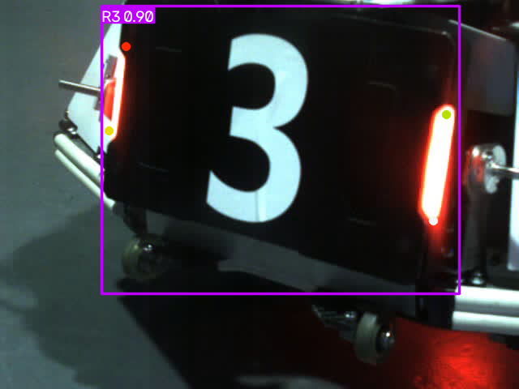
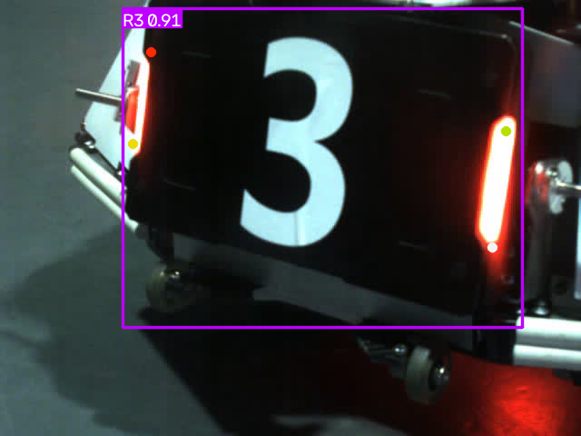
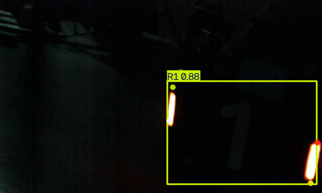

# RMStage2 训练记录 · 第二次（v2_finetune 微调/增量训练）

> lesson3 第二次训练记录。
> **增加了 169 张新（+2.7%），总体指标持平，B3 +1.5 点、R1 −3.8 点——增量太小，弱类提升被其他类的稀释抵消。**

---

## 1. 与初次训练区别

| 项 | 第一次（RMStage2-1） | **第二次（v2_finetune）** |
|---|---|---|
| 起始权重 | `yolo26n-pose.pt`（预训练） | `RMStage2-1/weights/best.pt`（**微调**） |
| 数据 | 5637 张 | 5812 张（+169 张新图） |
| 轮数 | 100 | **30** |
| 学习率 | 0.01 | **0.001**（低一个量级） |
| 其余增强 | — | 与第一次相同 |

**目的**：验证"补 169 张新数据能不能把弱类（B1/B3/R1）提上来"。

---

## 2. 数据

### 2.1 规模

| 分片 | 图片 | 实例 |
|---|---:|---:|
| train | **5812**（5637 原有 + 169 新增 + 6 背景） | ≈ 9450 |
| val | **1409**（未改动，与基线可比） | 2362 |

> 损坏文件 1 张（`516.jpg`，0 字节，已被自动跳过）；背景图 6 张（无目标，正常）。

### 2.2 新增 169 张的类别构成

| 类 | 新增实例 | 原有 | 增幅 |
|---|---:|---:|---:|
| BS | 40 | 289 | **+13.8%** |
| B3 | 73 | 594 | **+12.3%** |
| B2 | 29 | 788 | +3.7% |
| RS | 9 | 262 | +3.4% |
| R1 | 13 | 461 | +2.8% |
| R3 | 13 | 457 | +2.8% |
| B1 | 17 | 707 | +2.4% |
| R4 | 21 | 943 | +2.2% |
| B4 | 30 | 2057 | +1.5% |
| R2 | 6 | 904 | +0.7% |
| R5 | 1 | 718 | +0.1% |
| B5 / BO / RO | 0 | — | 0 |

**合计 252 个新实例，占原数据 +2.7%。**

只有 **B3 和 BS 达到了 +12% 以上**，其余全部低于 4%——这是本次结果的根本原因（见第 5 节）。

---

## 3. 训练配置

```yaml
model: runs/pose/RMStage2-1/weights/best.pt   # 从基线微调
data: armor_pose_v2.yaml                      # train=dataset_v2/train, val=dataset/val
epochs: 30
patience: 30
batch: 16
imgsz: 640
optimizer: SGD
lr0: 0.001
lrf: 0.01
warmup_epochs: 3
cos_lr: true
close_mosaic: 5
# 增强（与第一次相同）
hsv_h: 0.015
hsv_s: 0.7
hsv_v: 0.4
degrees: 0.0
translate: 0.1
scale: 0.5
mosaic: 1.0
fliplr: 0.5
flipud: 0.0
mixup: 0.0
copy_paste: 0.0
```

| 资源 | 数值 |
|---|---|
| GPU | RTX 5070 Ti Laptop（11.5 GB） |
| 单轮耗时 | **28.7 s** |
| 总时长 | **14.5 min** |
| 显存峰值 | 2.66 GB |
| 最优轮次 | 第 **17** 轮 |

---

## 4. 结果

### 4.1 总体指标（val 1409 张 / 2362 实例）

| 指标 | 第一次（基线） | **第二次（v2）** | 变化 |
|---|---:|---:|---:|
| Box P | 0.9366 | **0.9480** | +1.1 |
| Box R | 0.9064 | 0.9030 | −0.3 |
| Box mAP50 | 0.9499 | **0.9540** | +0.4 |
| Box mAP50-95 | 0.6748 | 0.6778 | +0.3 |
| Pose P | 0.8659 | 0.8762 | +1.0 |
| Pose R | 0.8387 | 0.8274 | −1.1 |
| **Pose mAP50** | **0.8406** | **0.8365** | **−0.4** |
| Pose mAP50-95 | 0.7659 | 0.7684 | +0.3 |

### 4.2 逐类 Pose mAP50

| 类 | 基线 | **v2** | 变化 | 判读 |
|---|---:|---:|---:|---|
| B1 | 0.621 | 0.608 | **−1.3** | 新数据只有 17 个实例，被稀释 |
| B2 | 0.863 | 0.863 | 0.0 | 无变化 |
| **B3** | 0.692 | **0.707** | **+1.5** | ✅ 新数据 73 个，唯一有明显增量的类 |
| B4 | 0.778 | 0.785 | +0.7 | 小幅 |
| B5 | 0.804 | 0.794 | −1.0 | 未覆盖 |
| BO | 0.966 | 0.966 | 0.0 | — |
| BS | 0.860 | 0.860 | 0.0 | 40 个新实例，未转化为提升 |
| **R1** | 0.726 | **0.688** | **−3.8** | ❌ 只有 13 个实例，样例明显被稀释 |
| R2 | 0.881 | 0.881 | 0.0 | — |
| R3 | 0.923 | 0.923 | 0.0 | — |
| R4 | 0.861 | 0.861 | +0.0 | — |
| R5 | 0.810 | 0.810 | −0.8 | — |
| RO | 0.978 | 0.978 | 0.0 | — |
| RS | 0.985 | 0.985 | 0.0 | — |

> 除 B3/B4 外，其余类变化都在噪声范围（±1 点）。

---

## 5. 结论

### 5.1 数据增量太小，且分布倾斜

**判据**：某类新增实例 ≥ 原有 15%，才可能有可测提升。

本次只有 B3（+12.3%）和 BS（+13.8%）接近这条线，其余 9 类都在 4% 以下。数学上：

```
新数据 252 个实例
÷ 14 类 = 平均每类 +18 个
某类原 594 个 → +73 个（+12%）→ 能测到
某类原 461 个 → +13 个（+2.8%）→ 完全测不到
```

**结果和计算完全吻合**：B3 +1.5，R1 −3.8。

### 5.2 R1 识别率下降

新增的 169 张里 R1 只有 13 个，而 B3/BS 增加了上百个。训练时梯度被 B3/BS 拉走，R1 反而更少被关注——**"加权"和"稀释"同时发生**。

### 5.3 同步出现的工程问题

| 现象 | 数据 |
|---|---|
| **B2 /R2 混淆严重** | 归一化混淆矩阵里，真 R2 有 34% 被判为 B2 |
| 原因 | 部分工程（B2/R2）装甲板没有 1–5 编号，蓝红两块板形状完全一样，唯一区别是灯条颜色；而 `hsv_s: 0.7` / `hsv_v: 0.4` 把颜色线索打散 |
| 实测验证 | 加了"颜色后处理"反而更差（93.1% → 83.9%），详见  |

---

## 6. 下一次（第三次）训练（初次训练）

| 改动 | 预期 |
|---|---|
|从 `yolo26n-pose.pt` **从头重训 100 轮** | 避免累积漂移，指标可解释 |

---

## 7. 复现步骤

```bash
cd ~/RMStage2/yolo26_pose_rmvision
source ~/RMStage2/.venv/bin/activate

# 1. 数据（dataset_v2/train = 原 5637 + 新 169；val 指向 dataset/val）
cat armor_pose_v2.yaml

# 2. 清缓存
find ~/RMStage2 -name labels.cache -delete

# 3. 训练（约 15 分钟）
python -u train.py --config train_config_v2.yaml 2>&1 | tee train_v2.log

# 4. 评估
yolo pose val model=runs/pose/v2_finetune/weights/best.pt data=armor_pose_v2.yaml imgsz=640
```

---

## 8. 产物

```
runs/pose/v2_finetune/
├── weights/best.pt            第 17 轮，5.9 MB
├── weights/last.pt            第 30 轮
├── results.csv                每轮指标
├── results.png                16 张曲线拼图
├── BoxPR / BoxP / BoxR / BoxF1_curve.png
├── PosePR / PoseP / PoseR / PoseF1_curve.png
├── confusion_matrix(_normalized).png
├── val_batch{0,1,2}_{labels,pred}.jpg
├── labels.jpg                 数据集统计
├── args.yaml                  本次全部参数
└── training_summary.json      结构化指标（脚本可读）
```

---

## 9. 本轮局限

1. **验证集没有更新**，指标偏乐观。
2. 只训了 30 轮，且是从基线微调——**不能代表"这套数据的真实上限"**（第三次会从头训 100 轮）。
3. 新增数据只有 169 张，**样本多样性未统计**（可能高度集中于少数场景）。
4. B2/R2 混淆问题未解决，只做了归因。

---

## 10. 总结

> 第二次训练**流程正确、结果持平**：+169 张（+2.7%）只能让 B3 涨 1.5 点，同时把 R1 拉低 3.8 点。
> **结论：增量低于 15% 时，单类提升会被其他类的稀释抵消——补数据必须补到"够改变分布"的量。**

---

## 推理可视化

由 `runs/pose/RMStage2-1_v2_finetune/weights/best.pt` 在验证集推理，框上标注类别与置信度，圆点为关键点。






