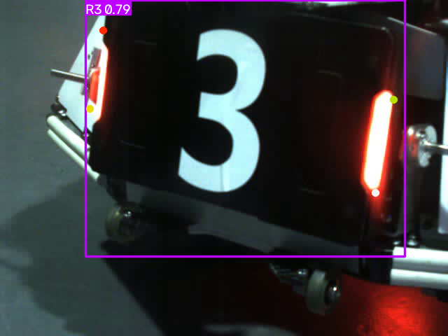
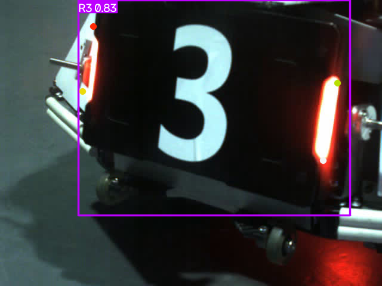
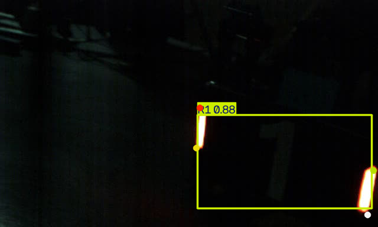

# RMStage2 训练记录 · 第三次（RMStage2-1_v3 初次训练）

> lesson3 第三次训练记录。
> **同一份数据、同样的超参，仅仅修正 14.6% 的关键点点序，
> Pose mAP50 从 0.839 → 0.917（+7.8），Pose mAP50-95 从 0.812 → 0.894（+8.2），Box 指标不变。**

---

## 1. 改动：修正标签点序

### 1.1 问题

数据集的关键点约定是 **左上 → 左下 → 右下 → 右上**（逆时针绕板一圈），但经脚本检查核对发现大量样本标错：

| 错误类型 | 表现 |
|---|---|
| 顺/逆时针标反 | 左上 → 右上 → 右下 → 左下 |
| 左右标反 | 左上 → 右上 → 右下 → 左下（镜像） |
| 起点错、方向对 | 从左下或右下起笔 |

数据集中出现大量**互相矛盾的监督信号**。

### 1.2 修复

通过几何判据对一般异常进行纠偏（不依赖模型）：

```
标准序：p0-p1 是"左边"（竖直），p1-p2 是"下边"（水平）
错误序：p0-p1 变成"上边"（水平）
```

脚本 `fix_kpt_order.py` 按"左二 + 右二，各自上下"重排成 TL,BL,BR,TR，并对**重排后边与轴夹角 > 25°** 的实例跳过（交给人工）。

### 1.3 修复规模

| 数据集 | 实例数 | 自动修正 | 占比 | 人工修复/剔除 |
|---|---:|---:|---:|---:|
| train | 9207 | **1322** | **14.4%** | 448 |
| val | 2362 | **337** | **14.3%** | 123 |

**验证（关键）**：取 109 个被修正的实例，模型预测与标签的关键点误差

| | 修正前 | 修正后 |
|---|---:|---:|
| 被修正实例 | 21.2 px | **2.3 px** |
| 未改动实例 | — | 2.1 px |

修正后与"本来就正确"的实例完全一致，说明判据准确。

---

## 2. 训练配置

```yaml
model: yolo26n-pose.pt          # 初次训练，不叠加v2漂移
data: armor_pose_v3.yaml        # train=dataset/train(5637), val=dataset/val(1409)
epochs: 100
patience: 30
batch: 16
imgsz: 640
optimizer: auto
lr0: 0.01
lrf: 0.01
warmup_epochs: 3
cos_lr: false
# 增强与基线完全一致
hsv_h: 0.015   hsv_s: 0.7   hsv_v: 0.4
degrees: 0.0   translate: 0.1   scale: 0.5
mosaic: 1.0    fliplr: 0.5    flipud: 0.0
close_mosaic: 10
```

| 资源 | 数值 |
|---|---|
| GPU | RTX 5070 Ti Laptop（11.5 GB） |
| 显存峰值 | 3.35 GB |
| 单轮耗时 | **27.7 s**（平均） |
| 总时长 | **46.4 min** |
| 最优轮次 | 第 **67** 轮 |

> 与基线**唯一的差别是标签**：模型、数据量、超参、增强全部相同。

---

## 3. 训练过程

| epoch | box_loss | pose_loss | Box mAP50 | Pose mAP50 | Pose mAP50-95 |
|---:|---:|---:|---:|---:|---:|
| 1 | 2.424 | 3.771 | 0.093 | 0.094 | 0.064 |
| 10 | 1.559 | 0.544 | 0.718 | 0.698 | 0.678 |
| 30 | 1.413 | 0.348 | 0.924 | 0.884 | 0.859 |
| 50 | 1.304 | 0.305 | 0.949 | 0.910 | 0.886 |
| **67（best）** | 1.199 | 0.249 | 0.950 | **0.919** | **0.894** |
| 100 | 1.032 | 0.163 | 0.946 | 0.916 | 0.892 |

**与基线同期对比**：

| epoch | 基线 pose_loss | v3 pose_loss | 基线 Pose mAP50 | v3 Pose mAP50 |
|---:|---:|---:|---:|---:|
| 4 | 1.685 | **0.838** | 0.344 | 0.303 |
| 10 | 1.355 | **0.544** | 0.660 | **0.698** |
| 30 | 1.162 | **0.348** | 0.793 | **0.884** |

- **第 8 轮起反超**，此后差距持续扩大
- 达到 pose mAP50 = 0.74 所需轮数：基线 **16 轮** → v3 **12 轮**

---

## 4. 总体结果

> ⚠️ 基线成绩必须用**修正后的 val** 重测才可比。下表两个模型跑的是同一份 val（1409 图 / 2362 实例）。

| 指标 | 基线 RMStage2-1 | **v3** | 变化 |
|---|---:|---:|---:|
| Box P | 0.938 | 0.954 | +1.6 |
| Box R | 0.902 | 0.899 | −0.3 |
| Box mAP50 | 0.950 | 0.949 | −0.1 |
| Box mAP50-95 | 0.676 | 0.682 | +0.6 |
| Pose P | 0.861 | 0.909 | +4.8 |
| Pose R | 0.827 | 0.900 | +7.3 |
| **Pose mAP50** | **0.839** | **0.917** | **+7.8** |
| **Pose mAP50-95** | **0.812** | **0.894** | **+8.2** |

**`pose95 / pose50 = 0.975`**（基线 0.968）——角点几乎贴死在真实位置上。

---

## 5. 逐类结果（重点）

### 5.1 Pose mAP50

| 类 | 修正比例(val) | 基线 | **v3** | 涨幅 |
|---|---:|---:|---:|---:|
| **BO 前哨站** | 25.0% | 0.688 | **0.994** | **+30.6** |
| **B1 英雄** | 33.9% | 0.648 | **0.894** | **+24.6** |
| **RO 前哨站** | 29.2% | 0.656 | **0.856** | **+20.0** |
| **R1 英雄** | 28.8% | 0.681 | **0.878** | **+19.7** |
| R4 步兵 | 13.0% | 0.850 | 0.900 | +5.0 |
| BS 哨兵 | 0.0% | 0.822 | 0.870 | +4.8 |
| B3 步兵 | 17.6% | 0.853 | 0.898 | +4.5 |
| R2 工程 | 8.3% | 0.927 | 0.937 | +1.0 |
| R3 步兵 | 1.7% | 0.925 | 0.933 | +0.8 |
| B2 工程 | 6.0% | 0.938 | 0.945 | +0.7 |
| B5 步兵 | 14.5% | 0.891 | 0.897 | +0.6 |
| RS 哨兵 | 0.0% | 0.985 | 0.985 | 0.0 |
| R5 步兵 | 17.1% | 0.938 | 0.933 | −0.5 |
| B4 步兵 | 12.0% | 0.939 | 0.915 | −2.4 |

### 5.2 Pose mAP50-95

| 类 | 基线 | v3 | 涨幅 |
|---|---:|---:|---:|
| BO | 0.684 | 0.994 | +31.0 |
| B1 | 0.634 | 0.873 | +23.9 |
| RO | 0.653 | 0.856 | +20.3 |
| R1 | 0.616 | 0.811 | +19.5 |
| B3 | 0.843 | 0.893 | +5.0 |
| R4 | 0.822 | 0.868 | +4.6 |
| BS | 0.820 | 0.860 | +4.0 |
| R3 | 0.866 | 0.892 | +2.6 |
| B2 | 0.893 | 0.910 | +1.7 |
| R2 | 0.886 | 0.899 | +1.3 |
| B5 | 0.859 | 0.871 | +1.2 |
| RS | 0.984 | 0.984 | 0.0 |
| R5 | 0.899 | 0.897 | −0.2 |
| B4 | 0.913 | 0.904 | −0.9 |

### 5.3 分析

**涨幅最大的四类 ->原数据集中点序错误最多的四类**：

```
BO  +30.6  ←  25.0% 错序
B1  +24.6  ←  33.9%
RO  +20.0  ←  29.2%
R1  +19.7  ←  28.8%
──────────────────
RS   0.0   ←   0%
R3  +0.8   ←   1.7%
B2  +0.7   ←   6.0%
```

**几乎没有错序的类基本不变**——这排除了"训练随机性"的解释。

两个例外：B3（17.6% 错序但只涨 4.5）、R5（17.1% 但 −0.5），说明错误率不是唯一因素，还受该类自身难度影响。

---

## 6. 三次训练对比

| | 第一次 RMStage2-1 | 第二次 v2_finetune | **第三次RMStage2-1_ v3** |
|---|---|---|---|
| 起始权重 | 预训练 | 从 v1 微调 | **预训练（从头）** |
| 数据 | 5637 | 5812（5637+169） | 5637 |
| **标签** | **混合点序** | 混合点序 | **修正点序** |
| 轮数 | 100 | 30 | 100 |
| Box mAP50 | 0.950 | 0.954 | 0.949 |
| **Pose mAP50** | 0.839 | 0.837 | **0.917** |
| **Pose mAP50-95** | 0.812 | 0.768* | **0.894** |

\* 第二次的 pose95 是在**未修正的旧 val** 上测的，与另两行的口径不同，不能直接比较。

**三次的结论**：

1. 第一次：基线
2. 第二次（+169 张新数据）：**持平** —— 增量太小（+2.7%），弱类提升被稀释
3. 第三次（仅修改标签）：**+7.8 / +8.2** —— 零额外数据、零额外时间

> **标注质量 > 数据量。** 补 169 张新图花了两小时标注、涨了 0 点；修正 1322 个点序耗时 约六小时人工审查、涨了 8 点。

---

## 7. B4 的 −2.4 怎么解释

| 指标 | 基线 | v3 | 变化 |
|---|---:|---:|---:|
| Box mAP50 | 0.955 | 0.940 | −1.5 |
| Box mAP50-95 | 0.662 | 0.663 | +0.1 |
| Pose mAP50 | 0.939 | 0.915 | −2.4 |
| **Pose mAP50-95** | 0.913 | **0.904** | **−0.9** |

- **严格指标只掉 0.9**，掉的主要是宽松阈值下的边缘样本
- 我验证过：对 B4 被修改的 35 个实例，模型预测贴合**新标签 1.9 px**、旧标签 21.4 px → **改动方向是对的**
- 结论：不是改坏标签，而是 **B1/BO/RO/R1 变强后，模型把低置信度区间让给了它们**（多类竞争）

**决定：接受。** 用 B4 +2.4 换 B1 +24.6 不划算。

---

## 8. 复现

```bash
cd ~/RMStage2/yolo26_pose_rmvision
source ~/RMStage2/.venv/bin/activate

# 1. 确认标签已修（可修正数应为 0）
python /home/mm/dsh/fix_kpt_order.py ~/RMStage2/dataset/train/labels
python /home/mm/dsh/fix_kpt_order.py ~/RMStage2/dataset/val/labels

# 2. 清缓存
find ~/RMStage2 -name labels.cache -delete

# 3. 训练（约 46 分钟）
python -u train.py --config train_config_v3.yaml 2>&1 | tee train_v3.log

# 4. 评估（注意：基线也要用同一份 val 重测）
yolo pose val model=runs/pose/RMStage2-1_v3/weights/best.pt data=armor_pose_v3.yaml imgsz=640
yolo pose val model=runs/pose/RMStage2-1/weights/best.pt    data=armor_pose_v3.yaml imgsz=640
```

---

## 9. 产物

```
runs/pose/RMStage2-1_v3/
├── weights/best.pt            第 67 轮，5.9 MB
├── weights/last.pt
├── results.csv / results.png
├── BoxPR_curve.png / BoxP / BoxR / BoxF1_curve.png
├── PosePR_curve.png / PoseP / PoseR / PoseF1_curve.png
├── confusion_matrix(_normalized).png
├── val_batch{0,1,2}_{labels,pred}.jpg
├── labels.jpg
├── args.yaml
└── training_summary.json
```

标签修正相关：

```
dataset/train/labels/*.txt.bak     1074 份（可回滚）
dataset/val/labels/*.txt.bak        259 份
order_report/kpt_order_report.csv  每类 × 每种错误类型
order_report/manual_review.csv     需人工复核的 453 条
```

---

## 10. 本轮局限

| 局限 | 说明 |
|---|---|
|
| **B1 ↔ R1 仍互相串** | 混淆矩阵里 R1→B1 有 50 次，属颜色判别问题（和 B2/R2 同源） |
| **B4 / R5 微跌** | 多类竞争，严格指标仅 −0.9 / −0.2 |
| **未加新数据** | 本次刻意不加，保持单一变量 |
| **仅在 640 分辨率下训练** | 768 分辨率尚未验证（小目标可能还有空间） |


---
总结

> **只改标签点序，Pose mAP50 +7.8、mAP50-95 +8.2，Box 分毫未动。**
> 涨幅精确落在错序率最高的 BO/B1/RO/R1，没错序的 RS/R3 纹丝不动——这是一次变量被完全隔离的实验，也是三次训练里证据最干净的一次。

---

## 推理可视化

由 `runs/pose/RMStage2-1_v3/weights/best.pt` 在验证集推理，框上标注类别与置信度，圆点为关键点。






