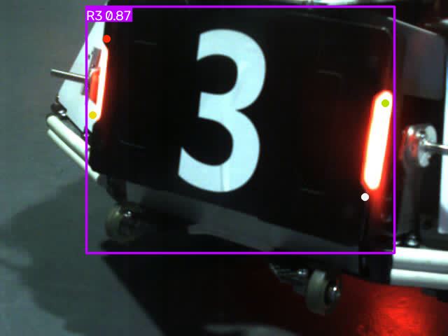
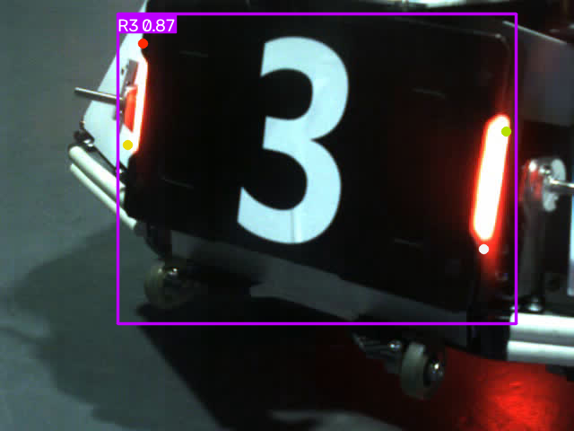
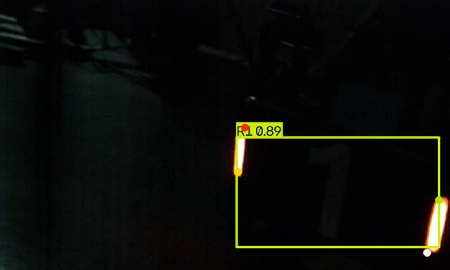

# RMStage2 训练记录 · 第四次（v4_finetune，B4 过采样）

> **一句话结论：把 B4 从 2057 个实例过采样到 3061（1.5×），再微调 20 轮——
> B4 的 pose mAP50 从 0.915 到 0.915，一点没动；总体 0.917 → 0.917，完全持平。**
>
> 这是一次**明确的负面实验**：证明 B4 的瓶颈不是样本数量。

---

## 1. 目的

第三次训练（v3）修好关键点点序后，唯一明显退化的类是 B4：

| 指标 | v3 | 基线 | 变化 |
|---|---:|---:|---:|
| B4 Pose mAP50 | 0.915 | 0.939 | −2.4 |
| B4 Pose mAP50-95 | 0.904 | 0.913 | −0.9 |

推测原因是"B1/BO/RO 变强后挤占了 B4 的置信度空间"。本实验验证：

> **给 B4 单独过采样 1.5× 再微调，能不能把 2.4 点补回来？**

---

## 2. 数据集构造

在 v3 数据集基础上，为**含 B4 的图片**各建一份硬链接副本：

| 项 | v3 | **v4** |
|---|---:|---:|
| train 图片 | 5637 | **6309**（+672） |
| val 图片 | 1409 | 1409（不变） |
| **B4 实例** | 2057 | **3061**（1.49×） |
| 其他类实例 | 不变 | 不变 |

- 副本后缀 `_os1`，**硬链接**（与原件共享 inode，不占额外磁盘）
- 只动 train，**val 一个字没改**
- 数据统计对比见 `labels.jpg`：B4 从 2040 涨到 3061

---

## 3. 复现脚本

`oversample_class.py` —— 按类别过采样 / 还原，幂等。

### 3.1 构造 v4 数据集

```bash
# 先看当前状态（不改文件）
python /home/mm/dsh/oversample_class.py --data ~/RMStage2/dataset/train --class B4 --factor 1.5

# 实际执行
python /home/mm/dsh/oversample_class.py --data ~/RMStage2/dataset/train --class B4 --factor 1.5 --apply
```

输出：

```
含 B4 的原图 : 1345 张
现有副本        : 0 张  →  当前约 1.00×
目标倍数        : 1.5×  需新增 672 张
manifest: .../dataset/train/.oversample_B4_1.50.json

新增 672 张，跳过已存在 0 张
当前训练集共 6309 张
```

### 3.2 还原数据集

```bash
python /home/mm/dsh/oversample_class.py --data ~/RMStage2/dataset/train --restore --apply
```

输出：

```
manifest .oversample_B4_1.50.json: 1344 个文件
已按 manifest 删除 1344 个文件
```


---

## 4. 训练配置

```yaml
data: armor_pose_v3.yaml          # train 指向 dataset/train（此时 6309 张）
model: runs/pose/RMStage2-1_v3/weights/best.pt   # 从 v3 微调
epochs: 20
patience: 30
batch: 16
imgsz: 640
# 未写 optimizer / lr0 → auto 会选 AdamW lr=5.56e-4
hsv_h: 0.015  hsv_s: 0.7  hsv_v: 0.4
scale: 0.5    mosaic: 1.0  close_mosaic: 10
```

| 项 | 数值 |
|---|---|
| 优化器 | **AdamW(lr=0.000556)**（auto 按 `nc=14` 自动算的） |
| 单轮耗时 | 31.3 s |
| 总时长 | **11.0 min** |
| 显存 | ~3.4 GB |

> 注意：`optimizer: auto` 会**忽略 lr0**，按 `0.002*5/(4+nc)` 计算学习率；
> `iterations < 10000` 时选 AdamW。20 轮 × 394 iter ≈ 7900，正好落在 AdamW 分支。

---

## 5. 结果

### 5.1 训练过程：**曲线是平的**

```
ep1 0.914 → ep5 0.912 → ep10 0.914 → ep13 0.919 → ep20 0.918
```

**第 1 轮就 0.914**（因为是从 v3 微调），20 轮里只在 ±0.005 内抖动，**没有任何学习斜率**。

### 5.2 总体指标

| 指标 | v3 | **v4** | 变化 |
|---|---:|---:|---:|
| Box mAP50 | 0.949 | 0.948 | −0.1 |
| Box mAP50-95 | 0.682 | 0.676 | −0.6 |
| Pose mAP50 | 0.917 | **0.917** | **0.0** |
| Pose mAP50-95 | 0.894 | 0.894 | 0.0 |
| 最优轮次 | 67 | 13 | — |

### 5.3 逐类 Pose mAP50

| 类 | v3 | v4 | 差 |
|---|---:|---:|---:|
| **B4（本次目标）** | 0.915 | **0.915** | **0.0** |
| B1 | 0.894 | 0.895 | +0.1 |
| B2 | 0.945 | 0.934 | −1.1 |
| B3 | 0.898 | 0.891 | −0.7 |
| B5 | 0.897 | 0.905 | +0.8 |
| BO | 0.994 | 0.995 | +0.1 |
| BS | 0.870 | 0.880 | +1.0 |
| R1 | 0.878 | 0.888 | +1.0 |
| R2 | 0.937 | 0.935 | −0.2 |
| R3 | 0.933 | 0.928 | −0.5 |
| R4 | 0.900 | 0.911 | +1.1 |
| R5 | 0.933 | 0.926 | −0.7 |
| RO | 0.856 | 0.859 | +0.3 |
| RS | 0.985 | 0.984 | −0.1 |
| **总体** | **0.917** | **0.917** | **0.0** |

**目标类没动，其余类 ±1 点内互有涨跌 —— 净效果为零。**

---

## 6. 为什么无效

### ① 不是"轮次不够"

如果是轮次问题，前 20 轮应该看到持续上升。实际是起手 0.914、收尾 0.918，
**中间没有斜率**——模型从第一轮起就在自己的平台上。再给 40 轮也是同一个平台。

### ② 不是"样本不够"

B4 有 **2057** 个实例，本来就是最大类。过采样到 **3061**（+49%）后指标一动不动。

### ③ 真正的瓶颈：类别混淆

B4 的误差主要来自与 **B3 / B5 / R4** 的混淆——都是步兵，装甲板外形一致，
**只有编号不同**。这种情况下：

- 加同类样本 → 模型见到的仍是"相似的板子"，学不到新的判别特征
- 提高分辨率 / 加强编号区域的特征 → 才可能有用

> 这和第 2 次训练（B2 ↔ R2 混淆 34%）是同一个问题：**无编号或编号细小的类别，靠数量补不回来。**

---

## 7. 结论与决策

| 决策 | 内容 |
|---|---|
| **是否继续更大轮次微调** | ❌ **不继续**。20 轮已证明平台上不去，更大学习率反而有破坏 v3 平衡的风险（v2 曾让 R1 掉 3.8） |
| **最终交付模型** | ✅ **选用 v3**（0.9193 / 0.8945），它的最优值比 v4 还高 0.0006 |
| **v4 的价值** | **结论**：过采样解决不了类别混淆型误差 |
| **数据集** | 已还原到 5637 张（与 v3 一致） |

---

## 8. 产物

```
runs/pose/RMStage2-1_v4_finetune/
├── weights/best.pt       第 13 轮
├── results.csv           20 轮曲线（平的）
├── PosePR_curve.png      逐类指标（B4 = 0.915）
├── confusion_matrix.png
└── training_summary.json
```

若以后要重建 v4 数据集：

```bash
python /home/mm/dsh/oversample_class.py --data ~/RMStage2/dataset/train --class B4 --factor 1.5 --apply
```

---

## 9. 总结

> **过采样 1.5× + 20 轮微调 → B4 的 0.915 一动不动。**
> 这不是"没训够"，是模型的判别瓶颈在**类别混淆**而非样本数量——所以把时间留给交付，用 v3 定稿。

---

## 推理可视化

由 `runs/pose/RMStage2-1_v4_finetune/weights/best.pt` 在验证集推理，框上标注类别与置信度，圆点为关键点。






